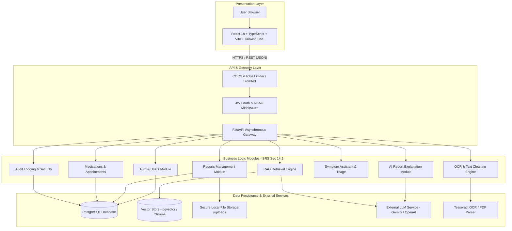

# MediLens AI - System Architecture Specification

## 1. High-Level Architecture (SRS Section 14)

MediLens AI utilizes a modular, layered client-server architecture designed for high maintainability, testability, and data isolation.

## 2. Security Boundaries & Invariants
- **BOLA / IDOR Defense**: All database queries enforce strict user tenant isolation: `user_id == current_user.user_id`.
- **Authoritative Source Invariant**: Uploaded original medical documents are never modified or overwritten by OCR/AI pipelines.
- **Safety Boundary**: The AI engine explicitly declines clinical diagnosis or medication modifications, attaching mandatory healthcare disclaimers.
