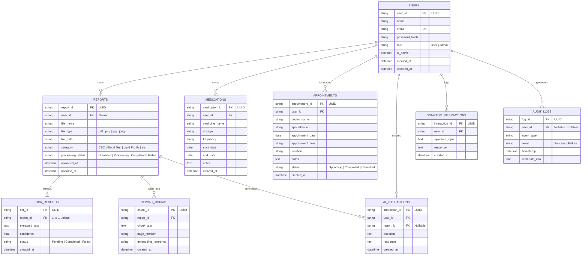

# MediLens AI - Entity Relationship (ER) Diagram

Based on **SRS Section 8 & Appendix B**, this diagram models the relational entities, primary keys, foreign keys, and cascading relationships for the MediLens AI platform.

